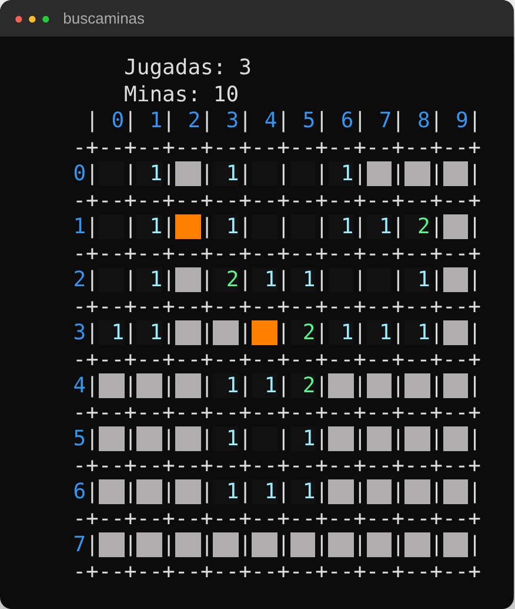

# 💣 Buscaminas en C++ (consola)


Versión del clásico **Buscaminas** para terminal, con tablero a color, descubrimiento de celdas en cascada,
deshacer jugadas y gestión de varias partidas guardadas en fichero.

Proyecto de la asignatura **Fundamentos de Programación II** (Grado en Ingeniería Informática, UCM, curso 2024/25),
centrado en **memoria dinámica y punteros**.

<p align="center">
  
</p>

## ✨ Características

- **Descubrimiento recursivo**: al abrir una celda vacía se destapa toda la zona hasta los bordes numéricos.
- **Varias partidas**: se cargan de fichero en un *array dinámico de punteros* ordenado por dificultad,
  que se redimensiona al insertar.
- **Partidas aleatorias** con dimensiones y número de minas elegidos por el jugador.
- **Deshacer (undo)** de las últimas jugadas, guardando las posiciones descubiertas en cada una.
- **Marcar / desmarcar** minas sospechosas.
- **Guardado** de las partidas pendientes al salir.
- **Interfaz a color** con secuencias ANSI.
- **Sin fugas de memoria**: en Visual Studio (modo Debug) se activa el detector de fugas del CRT.

## 🚀 Compilar y ejecutar

**g++ (Linux, macOS, MinGW en Windows):**

```bash
g++ -std=c++17 -Wall src/*.cpp -o buscaminas
./buscaminas
```

**Visual Studio:** crea un proyecto de consola vacío, añade los ficheros de `src/` y ejecuta.

Al arrancar pide el fichero de juegos: usa `juegos.txt` (incluido como ejemplo).

## 🎮 Cómo se juega

En cada turno se introduce `fila columna`:

| Entrada      | Acción                                    |
|--------------|-------------------------------------------|
| `f c`        | Descubre la celda (f, c)                  |
| `-2 -2`      | Marcar / desmarcar una mina (pide la posición) |
| `-3 -3`      | Deshacer la última jugada                 |
| `-1 -1`      | Abandonar (la partida se puede guardar)   |

Al terminar se pide el fichero donde guardar las partidas. La partida jugada se elimina si se gana o se pierde,
y se conserva si se abandona.

## 📄 Formato del fichero de juegos

```
2        ← número de juegos
3 3      ← filas columnas
1        ← número de minas
0 0      ← posición de cada mina (fila columna)
4 4
3
0 0
1 1
2 3
```

## 🗂️ Estructura

Diseño modular: cada módulo ofrece un tipo y las operaciones sobre él.

| Módulo            | Responsabilidad                                                    |
|-------------------|--------------------------------------------------------------------|
| `Celda`           | Estado de una celda: vacía, número o mina; visible y marcada       |
| `Tablero`         | Matriz de celdas y validación de posiciones                        |
| `Juego`           | Reglas: colocar minas, jugar (recursivo), victoria y dificultad   |
| `ListaJuegos`     | Array dinámico de punteros a juegos, ordenado por dificultad       |
| `ListaPosiciones` | Array dinámico de posiciones descubiertas en una jugada            |
| `ListaUndo`       | Historial de jugadas para deshacer                                 |
| `InputOutput`     | Dibujo del tablero a color, menús y lectura/escritura de ficheros  |
| `Main`            | Flujo de la partida                                                |

## 👥 Autores

- **Xiang Lin**
- **Mario Rosell**

Licencia [MIT](LICENSE).
